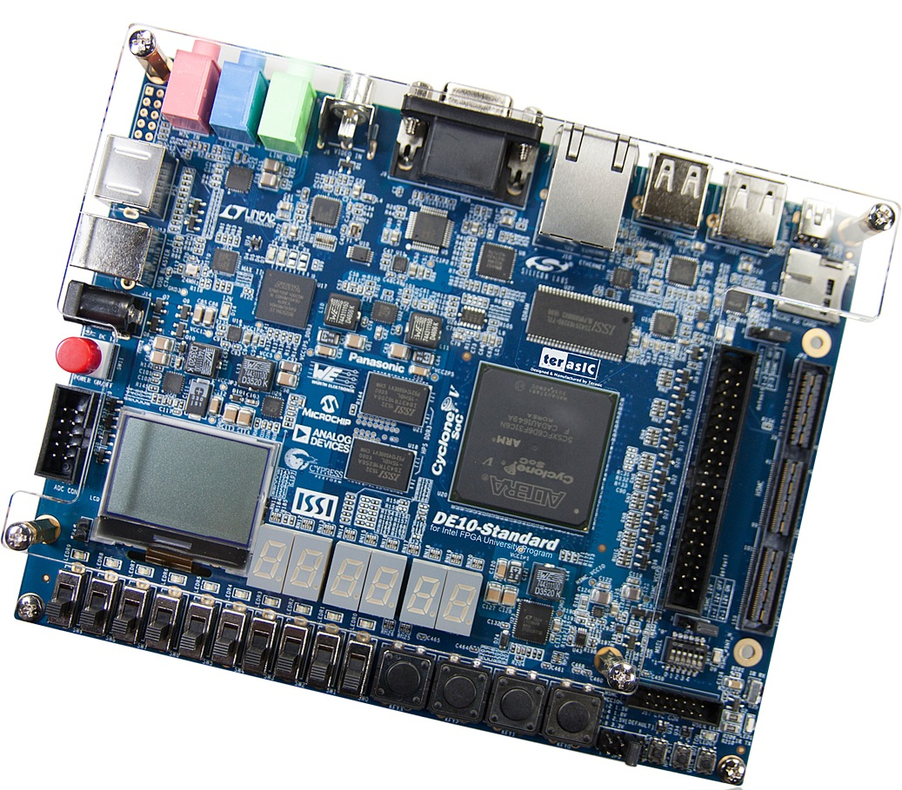
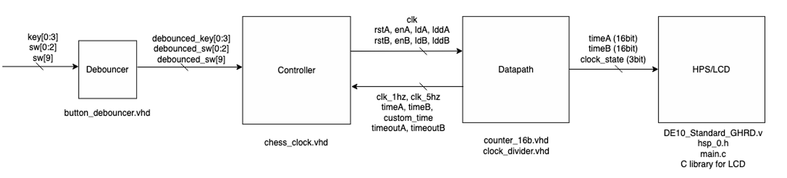
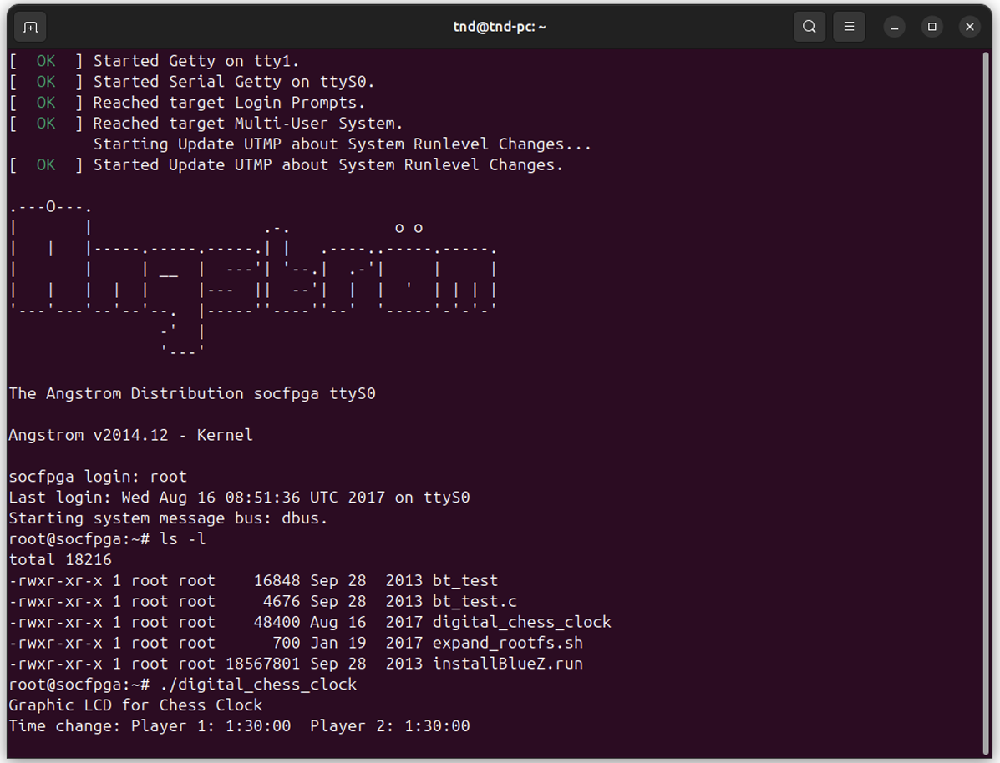
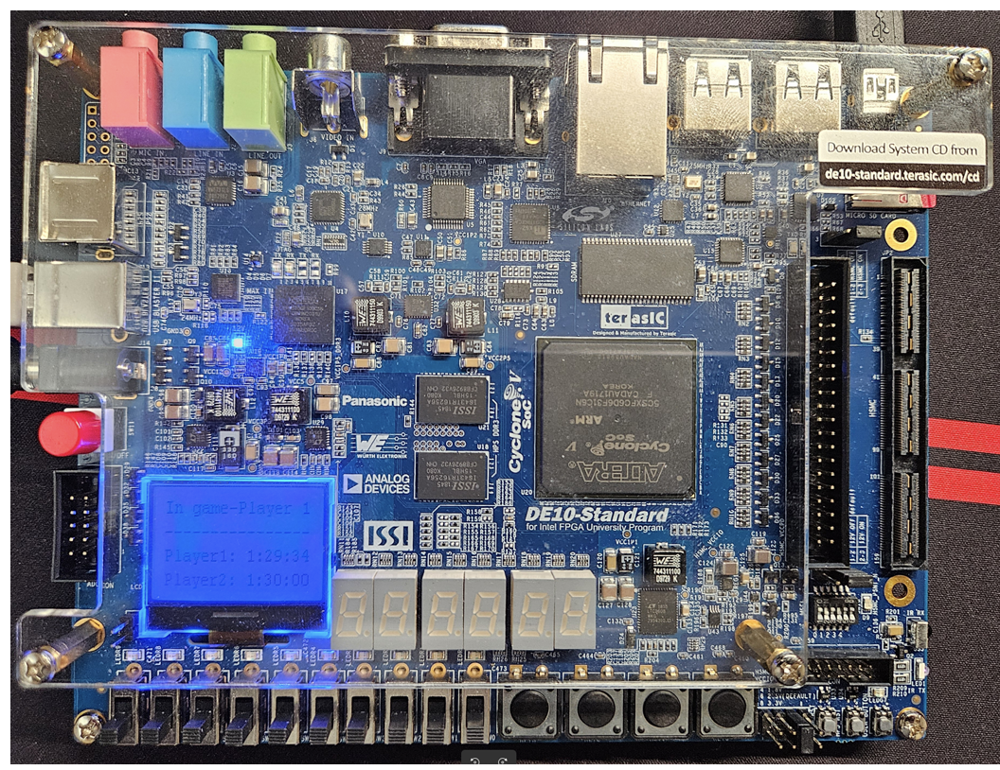

# Digital Chess Clock With LCD Display: An FPGA Implementation.
A university project focused on learning FPGA design and VHDL using the DE10-Standard development board.
<br>This project was designed and implemented within more than 1 week, and completed in April 2025. Due to time constraints, I was unable to implement all the features available in commercial chess clock. 


## 1. Prerequisites
### 1.1 Hardware:
- Terasic DE10-Standard board.
- MicroSD Card with a minimum of 4GB.
<p align="left">
  
</p>

### 1.2 Software
- **Quartus**: selecting Cyclone V device support, for FPGA development 
    - In Linux, the sopc_builder tool path should be manually updated to the ~/.bashrc or ~/.profile as below so their tools can be used in the Linux terminal later. Remember to `source` the changed file or reload your bash shell to apply the changes. 
        ```
        if [ -d "$HOME/intelFPGA_lite/24.1std/quartus/sopc_builder/bin" ] ; then
           PATH="$HOME/intelFPGA_lite/24.1std/quartus/sopc_builder/bin/:$PATH" 
        fi
        ```

- **ModelSim**: for FPGA Verilog/VHDL simulation, can be replaced by Questa

- **SoC EDS**: for HPS development 

- **IDE for HPS application in C**: Visual Studio Code or any IDE that you are familiar with.

- **Toolchain for ARM cross-platform compilation (GCC)**: 
    - In Linux, the general-purpose ARM cross-compiler is installed by command: `sudo apt install gcc-arm-linux-gnueabihf`.
    
    - In Windows, the toolchain (arm-none-linux-gnueabihf) can be downloaded from the ARM website https://gitlab.arm.com/tooling/gnu-toolchains-for-arm
    
    - Other option is to download the Linaro GCC toolchain from https://releases.linaro.org/components/toolchain/binaries/7.4-2019.02/arm-linux-gnueabihf/ 
    

### 1.3 Bootable MicroSD Card with Linux Console System
- Download the image file for Linux Console (Kernel 4.5) from the Terasic website and flash to the SD Card using BalenaEtcher or Win32 Disk Imager
https://www.terasic.com.tw/cgi-bin/page/archive.pl?Language=English&CategoryNo=205&No=1081&PartNo=4 After flashing the image to the SD Card, two new partitions are expected to appear. 
    - FAT32 partition: around 524 MB, storing bootloader, kernel image, etc. 
    - Ext4 partition: around 1.1 GB, storing root filesystem, Linux Console environment.


# 2. High-Level Design

## 2.1 Design Overview
The simple chess clock design is as below. 


**Using 4 keys and 4 switches to control the digital chess clock.**
- KEY[0]: Reset button
- KEY[1]: Start/Resume button
- KEY[2]: Pause/Decrease button
- KEY[3]: Increase button

**Initial Time setup:**
- SW[2]: Flip to select Classical game (90 minutes) - highest priority
- SW[1]: Flip to select  Rapid game (30 minutes) - medium  priority
- SW[0]: Flip to select Bliz game (10 minutes) - lowest priority
- When the game is not started, flip all SW[2], SW[1], SW[0] off, then use the KEY[2] or KEY[3] to change the initial time.

**Start the game:**
- Press KEY[1] to start the game
- During the game, user can press KEY[2] to pause the game and then KEY[1] to resume. 

**Select player:** use SW[9]
- SW[9] off (=0): Player 1 turn
- SW[9] on  (=1): Player 2 turn

## 2.2 ASM Design
The ASM design is simple with 6 states: INIT, READY, PLAYER_A, PLAYER_B, PAUSE, and COMPLETE. 


## 2.3 HPS Design
In the HPS part, a C-code project is designed and implemented to run on the Linux Console system booted from the MicroSD Card on the DE10-Standard board. This C application reads and processes raw data from FPGA and displays chess clock information on the LCD 128x64. The processing of raw data from FPGA is as follows.
- 16 bits for the chess clock of Player 1 and 16 bits for Player 2: the received data is the number of seconds, so they need to be converted to hours, minutes, and seconds. 
- 3 bits for chess clock modes, the “state” variable 

The LCD 128x64 is formatted to display characters in 16 columns x 4 lines. The first line is for displaying clock modes, and the third and the last lines are for displaying the player clocks. 

`  {Clock mode} `  <br>
`----------------` <br>
`Player1: H:MM:SS` <br>
`Player2: H:MM:SS` <br>


The driver for sending data from the HPS to the LCD via the Serial Peripheral Interface (SPI) is available in the DE10-Standard SystemCD under the directory “Demonstration/SoC/hps_lcd,” so there is no need to write new code for this interface.

The SoC EDS and the toolchain for ARM cross-platform compilation are required to compile this C application for the HPS’s ARM Cortex-A9 core. Refer to the Prerequisites section above for more information. 


# 3. Implementation

Design and source code in VHDL of the FPGA part: [DE10_Standard](/DE10_Standard_GHRD/).
<br>The FPGA part (.sof) can be loaded to the DE10-Standard board via the USB-Blaster II port.

Source code in C of the HPS part:  [HPS_LCD](/hsp_lcd/)
<br>The C project can be compiled using the ARM cross-platform compilation (GCC) and copied to the SD Card manually.

# 4. Test
In Linux, we can also use the terminal command `screen`, example `screen /dev/ttyUSBx 115200,cs8` to log in to the Linux system running on the board, then we can run the HPS application.
<br>In Windows, we can use puTTY, or we can simply use the Serial Monitor extension in Visual Studio Code.

<p align="left">
  
</p>

<p align="left">
  
</p>
